# Tutorial 01 — Answers

## Part I

### Question 1

1. IPO Model:

| Input | Process | Output |
| :--- | :--- | :--- |
| Two numbers (num1, num2) | Multiply num1 and num2 | The multiplication result |

2. Pseudocode:

```text
Start
    Read num1, num2
    result ← num1 * num2
    Print result
End
```

3. Flow chart :
   
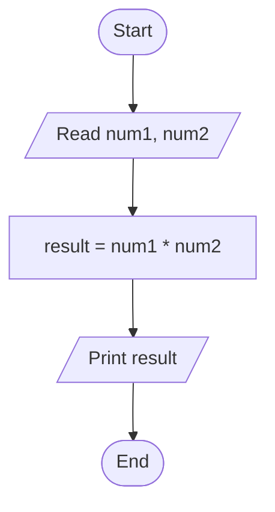
### QUESTION 2

1. IPO Model:

| Input | Process | Output |
| :--- | :--- | :--- |
|A random number| Compare n > 50 | comparison result (greater or not greater) |

2. Pseudocode:

```text
Start
Generate a random number, n
    If n > 50 then
        Print "The number is greater than 50"
    Else
        Print "The number is not greater than 50"
    End If
End
```
3. Flow chart :
   
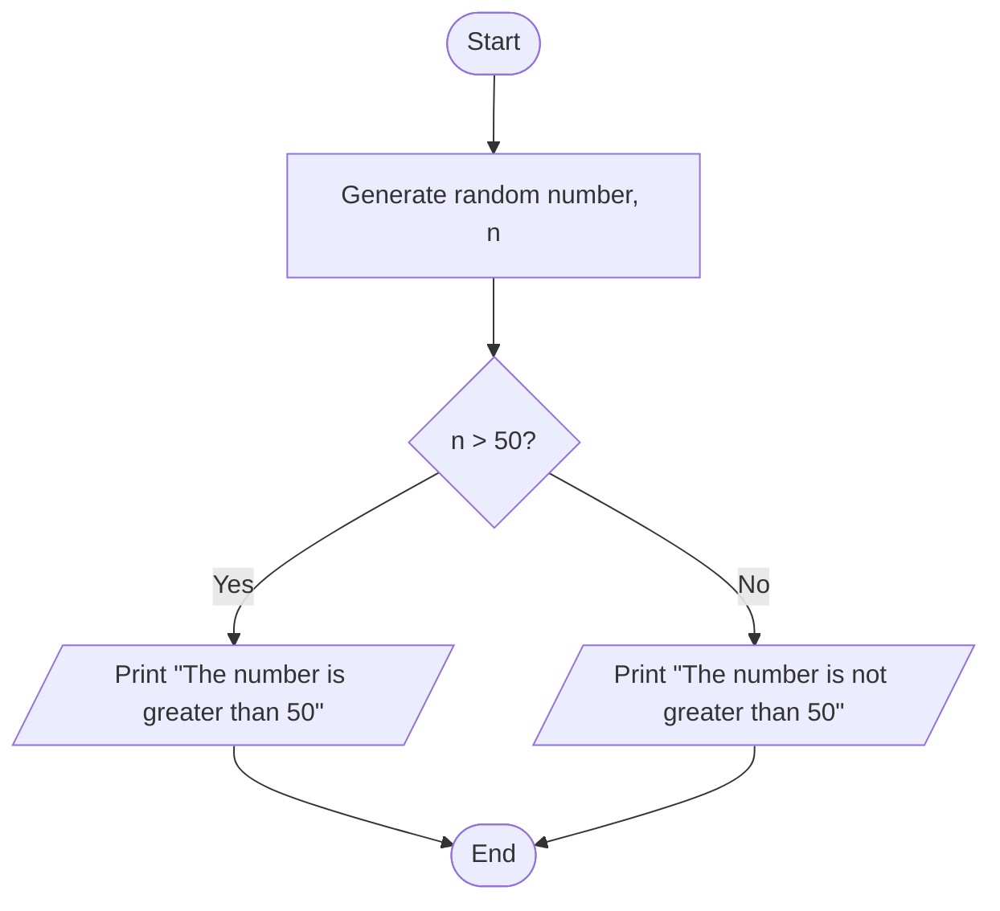
### QUESTION 3 

1. IPO Model:

| Input | Process | Output |
| :--- | :--- | :--- |
|User's mark| compare mark >= 40 , mark is 0-100 | pass, fail, invalid mark |

2. Pseudocode:

```text
Start
Read mark
    If mark <0 or > 100 then
        Print "Invalid mark"
    Else if mark >= 40
        Print "Pass"
    Else
        Print "Fail"
    End If
End
```
3. Flow chart :
   
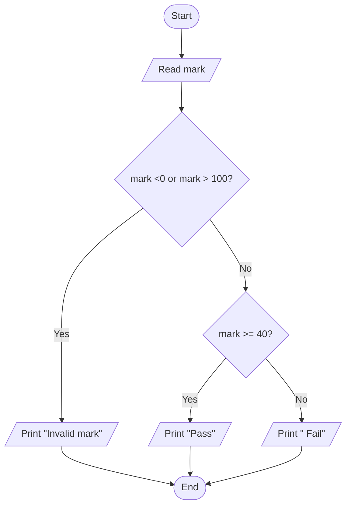

### QUESTION 4

1. IPO Model:

| Input | Process | Output |
| :--- | :--- | :--- |
|Random number of dice values in 0-6 of player 1 and player 2| compare dice value of player 1 and player 2| win, draw |

2. Pseudocode:

```text
Start
 Generate dice value for player 1 (p1)
 Generate dice value for player 2 (p2)
    If p1 > p2 then
        Print "Player 1 wins"
    Else If p2 > p1 then
        Print "Player 2 wins"
    Else
        Print "It is a draw"
    End If
End
```
3. Flow chart :
   
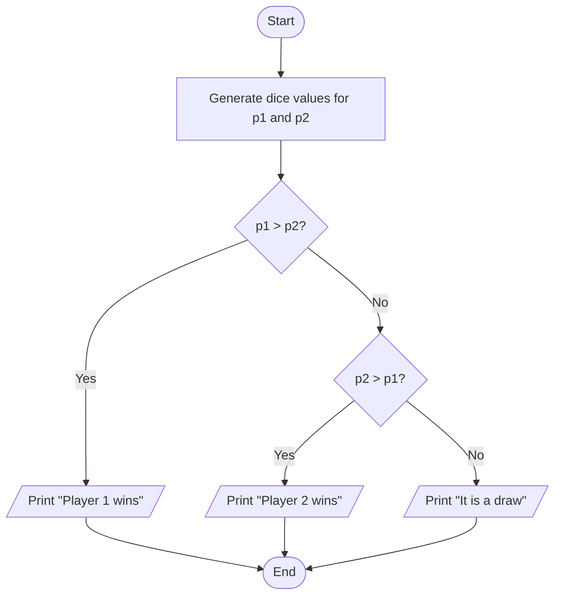

### QUESTION 5

1. IPO Model:

| Input | Process | Output |
| :--- | :--- | :--- |
|Length and width| Perimeter = 2 × (length + width)| perimeter of rectangle |

2. Pseudocode:

```text
Start
    Read length, width
    Calculate perimeter ← 2 * (length + width)
    Print perimeter
End
```

3. Flow chart :
   
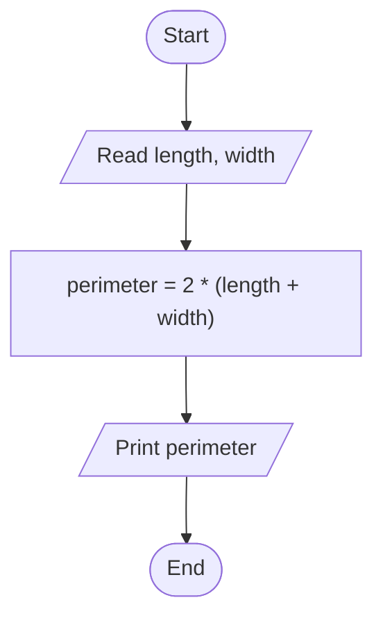

### QUESTION 6

1. IPO Model:

| Input | Process | Output |
| :--- | :--- | :--- |
|10 random numbers| Loop 10 times to generate numbers and compare each with the current minimum to find the smallest| Minimum number |

2. Pseudocode:

```text
Start
Set counter ← 1
    Generate first random number, min_num
    While counter < 10
        Generate new random number, num
        If num < min_num then
            min_num ← num
        End If
        counter ← counter + 1
    End While
    Print min_num
End
```
3. Flow chart :
   
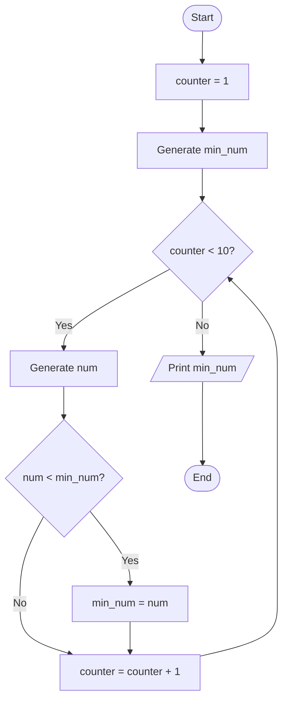
### QUESTION 7

1. IPO Model:

| Input | Process | Output |
| :--- | :--- | :--- |
|10 random numbers in 10–100| Loop 10 times to generate numbers (10-100),test n % 2 == 0 to identify even or odd| Total count of even number and odd number|

2. Pseudocode:

```text
Start
Set even_count ← 0, odd_count ← 0, counter ← 0
    While counter < 10
        Generate random number (num) between 10 and 100
        If num % 2 == 0 then
            even_count ← even_count + 1
        Else
            odd_count ← odd_count + 1
        End If
        counter ← counter + 1
    End While
    Print even_count, odd_count
End
```

3. Flow chart :
   
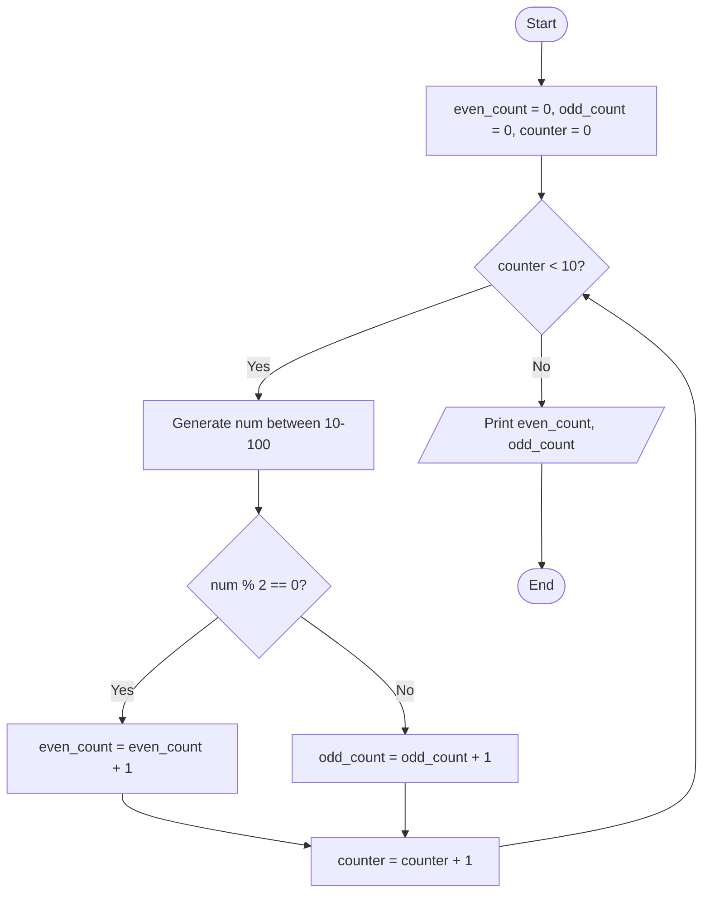

## Part II

### Question 8

 1. IPO Model:

| Input | Process | Output |
| :--- | :--- | :--- |
|A sentence|Count 'U' and 'M'|Number of  'U' and 'M'|

2. Pseudocode:

```text
Start
Set countU ← 0, countM ← 0,index ← 0
    Read sentence
    WHILE index < LENGTH(sentence) DO
    ch ← CHARACTER_AT(sentence, index)
        If character == 'U' then
            countU ← countU + 1
        Else if character == 'M' then
            countM ← countM + 1
        End If
        index ← index + 1
    END WHILE
    Print countU, countM
End
```
3. Flow chart :
   
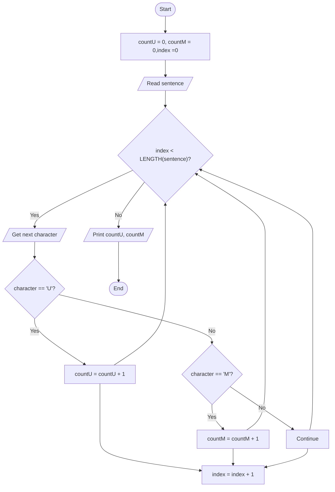

### QUESTION 9

1. IPO Model:

| Input | Process | Output |
| :--- | :--- | :--- |
|Webpage content,keyword|Search the web page content for the keyword and count how many times it appears|Frequency of a keyword|

2. Pseudocode:

```text
Start
Set frequency = 0
    Read web_page_content, keyword
    While keyword is found in web_page_content
        frequency = frequency + 1
        Move to the next search position
    End While
    Print frequency
End
```

3. Flow chart :
   
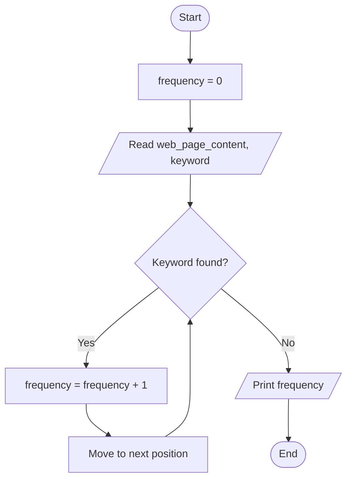

### QUESTION 10

1. IPO Model:

| Input | Process | Output |
| :--- | :--- | :--- |
|List of 100 students| Loop 100 times, check if the student's gender is female  and increment the counter|Number of female students |

2. Pseudocode:

```text
Start
Set female_count = 0, counter = 0
    While counter < 100
        Read student_gender
        If student_gender == "female" then
            female_count = female_count + 1
        End If
        counter = counter + 1
    End While
    Print female_count
End
```

3. Flow chart :
   
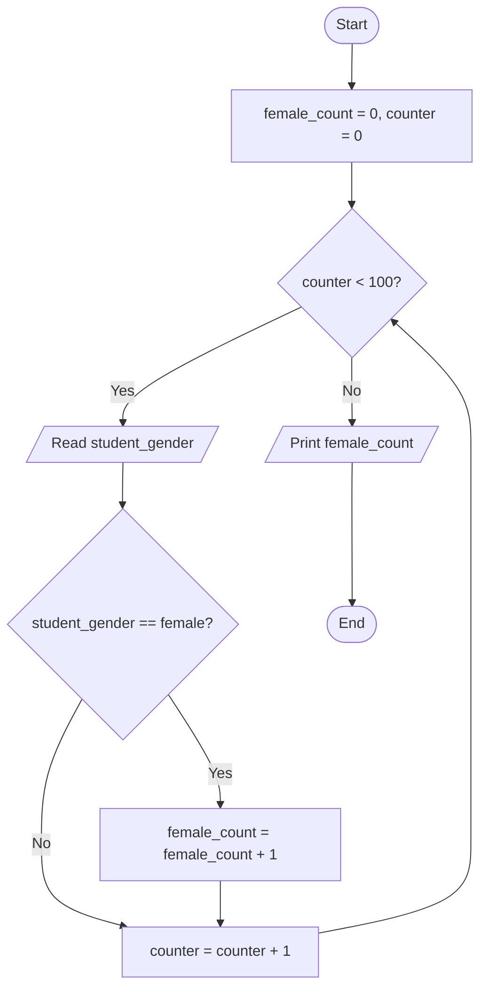

### QUESTION 11

1. IPO Model:

| Input | Process | Output |
| :--- | :--- | :--- |
|5 random numbers | Store the numbers in a list and sort the list in descending order|Descending list |

2. Pseudocode:

```text
Start
 // Phase 1: Generate and store 5 numbers
    Initialise a counter as 1
    While the counter is less than or equal to 5
        Randomly generate a number
        Store the number in a list
        Increase the counter by 1
    End While

// Phase 2: Bubble sort in descending order
    Initialise an iteration as 1
    While the iteration is less than the total number in the list
        For each number in the list
            If the current number is less than the next number then
                Assign the current number to the temporary number
                Assign the next number to the current number
                Assign the temporary number to the next number
            End If
        End For
        Increase iteration by 1
    End While

// Phase 3: Print the sorted list
    For each number in the sorted list
        Print the number
    End For
End
```

3. Flow chart :
   
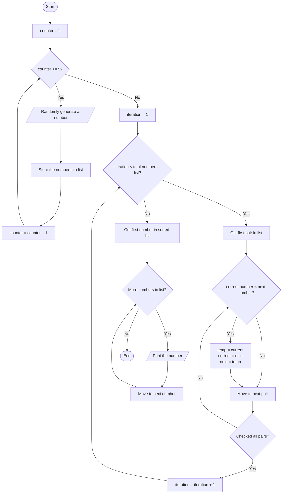

### QUESTION 12

1. IPO Model:

| Input | Process | Output |
| :--- | :--- | :--- |
|User's guess| Compare user's guess with target|Higher, Lower or Correct |

2. Pseudocode:

```text
Start
Generate a random number
    Read user_guess
        If user_guess < random_number then
            Print "lower"
        Else if user_guess > random_number
            Print "higher"
        Else
            Print "correct"
    End if
End
```

3. Flow chart :
   
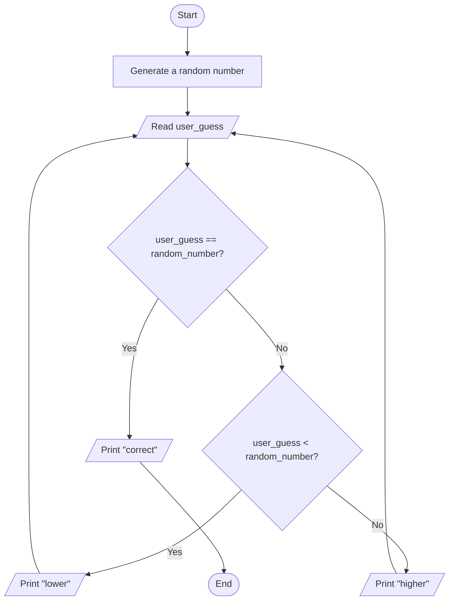